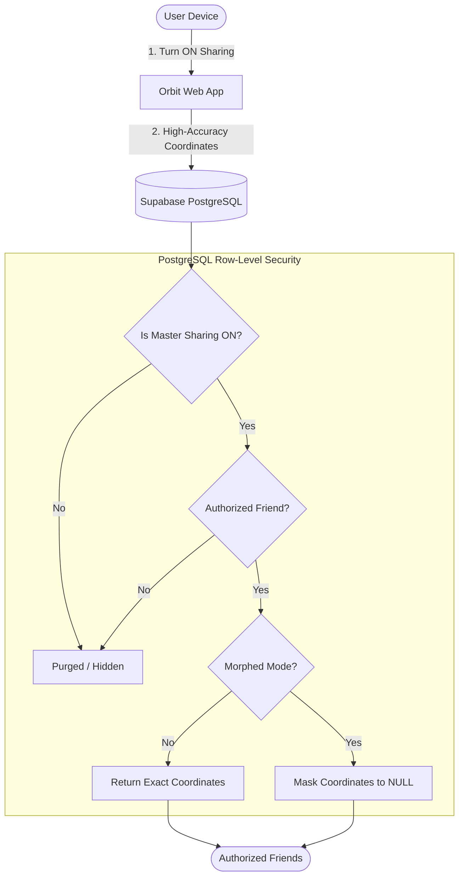

# 🛰️ Orbit — Find Your People

<div align="center">


**Real-World Connection, Uncompromised Privacy.**  
A modern full-stack social geolocation application built with React, Leaflet, and Supabase.

[Live Demo](https://my-orbit-seven.vercel.app) • [Architecture](#-core-privacy-architecture) • [Getting Started](#-getting-started) • [Creator](#-creator)

</div>

---

## ✨ Features

- 📍 **Live Interactive Radar**: Discover nearby friends with real-time coordinate updates and customizable radius filters (1km, 5km, 10km, 25km, or all).
- 🛡️ **Zero-Leak Privacy by Default**: Location broadcasting is **strictly OFF by default**. Being friends never exposes your coordinates until both parties explicitly opt in.
- 🎭 **Morphed Presence Mode**: Let your trusted circle know you are active and nearby while automatically masking your precise coordinates to `NULL` at the PostgreSQL RLS layer.
- ⚡ **Instant Kill Switch**: Stop broadcasting anytime with a single tap. Background geolocation watchers terminate immediately, and coordinate records are instantly wiped from the database.
- 🌓 **Dynamic Theme System**: Sleek modern Dark Mode and clean Light Mode with high-contrast map tiles.
- 📱 **Mobile Native Experience**: Optimized for iOS and Android viewports with safe-area notch insets, collapsible drawers, and native bottom navigation.
- 🔐 **Dual Authentication**: Sign in via Supabase Email/Password or 1-click Google OAuth with automated user synchronization.

---

## 🏛️ Core Privacy Architecture



---

## 🛠️ Tech Stack

| Layer | Technologies |
| :--- | :--- |
| **Frontend** | React 19, TypeScript, Vite, Tailwind CSS, Lucide Icons, React Router v7 |
| **Mapping Engine** | Leaflet, React-Leaflet, OpenStreetMap Tile Layers with Dark Mode CSS Filters |
| **Backend & DB** | Supabase (PostgreSQL, Row Level Security, Realtime Subscriptions, Database Triggers) |
| **Authentication** | Supabase Auth (Email / Password + Google OAuth 2.0 PKCE) |
| **Deployment** | Vercel (Frontend SPA) + Supabase Cloud (Database & Auth) |

---

## 🚀 Getting Started

### 1. Clone & Install Dependencies

```bash
git clone https://github.com/vikki123224v/My-Orbit.git
cd My-Orbit
npm install
```

### 2. Configure Environment Variables

Create a `.env` file in the project root:

```bash
cp .env.example .env
```

Add your Supabase project keys:

```env
VITE_SUPABASE_URL=https://your-project-id.supabase.co
VITE_SUPABASE_ANON_KEY=eyJhbGciOiJIUzI1NiIsInR5cCI6IkpXVCJ9...
```

### 3. Apply Supabase Database Migrations

Run the SQL migration scripts located in `supabase/migrations/` in your **Supabase Dashboard → SQL Editor**:

1. `20261020000000_orbit_initial_schema.sql` (Creates core tables, RLS policies, and geo functions)
2. `20261020000005_fix_google_oauth_and_presence.sql` (Adds OAuth triggers and presence preferences policies)

### 4. Run Locally

```bash
npm run dev
```

Open [http://localhost:5173](http://localhost:5173) in your browser.

---

## 👨‍💻 Creator

Crafted with ❤️ and precision by:

**Vighnesh**
- GitHub: [@vikki123224v](https://github.com/vikki123224v)
- Project: [My-Orbit](https://github.com/vikki123224v/My-Orbit)

---

## 📄 License

This project is licensed under the [MIT License](LICENSE).
